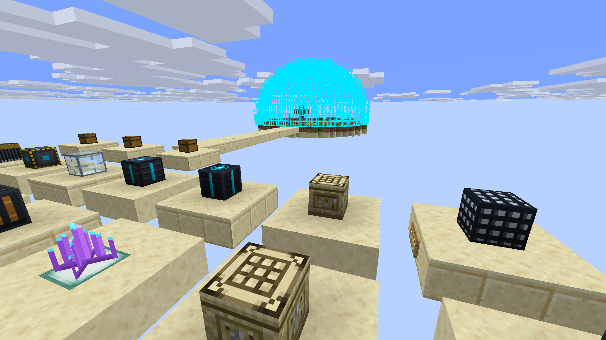
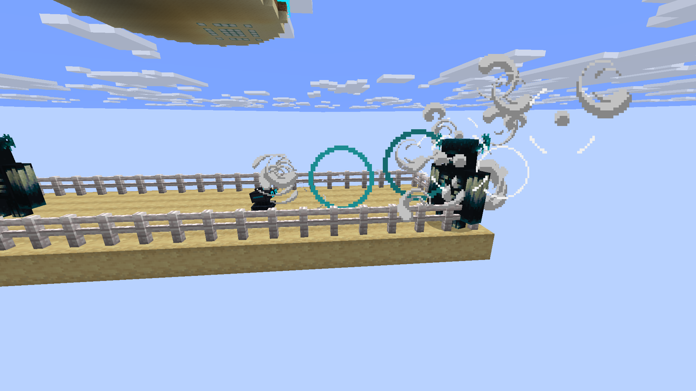
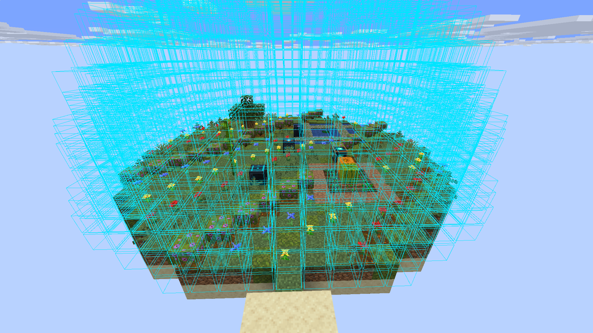
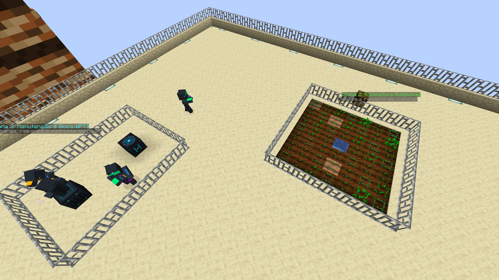
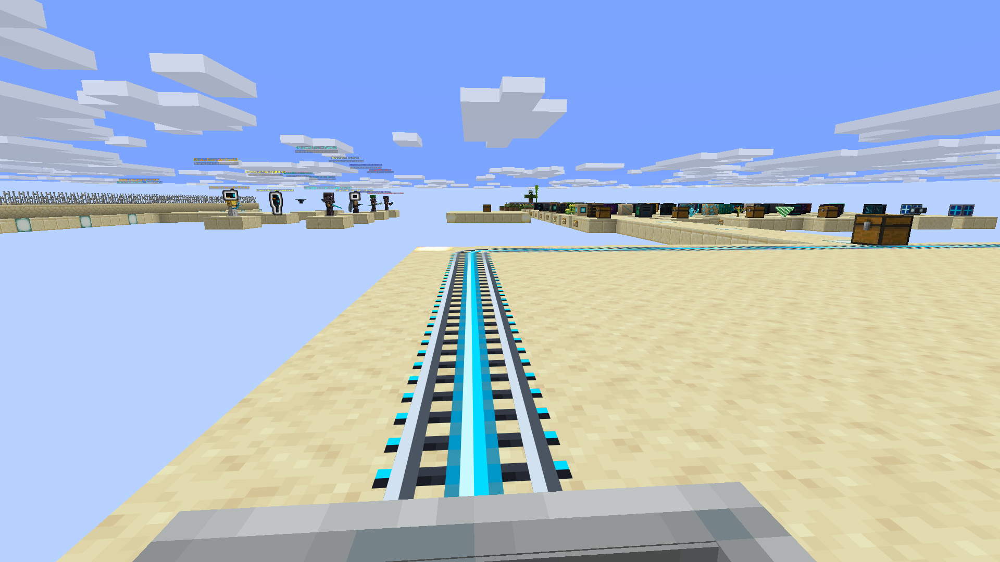

# SandStorm

**SandStorm** é um mod de sobrevivência planetária, automação industrial e terraformação para **Minecraft 26.3** (Fabric / Java 25).

Você aterrissou em um planeta desertificado e hostil, infestado por colossais **Vermes de Areia**. Sobreviva ao calor extremo, construa fábricas automatizadas, extraia água de aquíferos subterrâneos e transforme o deserto em um oásis verdejante.

---

### 📸 Demonstração em Jogo

| Defesa Planetária & Combate | Cúpula de Escudo & Terraformação |
|:---:|:---:|
|  |  |
| *Torretas sônicas repelindo ameaças sem alertar os predadores* | *Cúpula de plasma blindando o oásis verdejante contra o deserto* |

| Automação & Ciborgues | Transporte Ferroviário Maglev |
|:---:|:---:|
|  |  |
| *Ciborgues operando agricultura e estações de recarga WPT* | *Linhas de levitação magnética de alta velocidade no solo árido* |

---

### ⚙️ Destaques Principais

* **Sobrevivência 24/7:** O Sol recarrega seu traje espacial termorregulador. Camas não funcionam (sem pulo de noite ou tempestades).
* **Vermes de Areia:** Predadores colossais que caçam por ressonância sísmica. Use *Thumpers* para desviar sua atenção. (Suas máquinas e fábricas nunca são destruídas).
* **Indústria & Automação:** Transmissão de energia sem fio (WPT), filtragem osmótica de água, manufatura aditiva 3D e fabricação de nanorobôs.
* **Ciborgues & Robótica:** Imprima ciborgues inteligentes e configure patrulhas, agricultura estéril e manutenção perimétrica.
* **Terraformação Setorial:** Cúpulas de microclima e geradores de escudo de plasma para converter dunas em solo fértil com água doce e flora sustentável.

---

### 📖 Wiki Oficial & Tutoriais

Tudo o que você precisa saber (diagramas de engenharia, listas de itens, receitas e tutoriais passo a passo) está na **[Wiki Oficial do SandStorm no GitHub](https://github.com/fhfelipefh/SandStorm/wiki)**.

---

### 🛠️ Instalação (Minecraft 26.3 / Java 25)

> ⚠️ **Aviso de Versão:** O SandStorm utiliza a arquitetura moderna de renderização e desofuscação do **Minecraft 26.3** e exige **Java 25**. Ele não é compatível com versões legadas como Minecraft 1.21.4.

1. No seu launcher (CurseForge, Prism ou Oficial), selecione ou crie um perfil para o **Minecraft 26.3** com **Fabric Loader (0.19.0+)**.
2. Certifique-se de que a JVM do perfil utiliza **Java 25** (padrão do Minecraft 26.3).
3. Adicione o `.jar` do **SandStorm** e a **Fabric API para 26.3** na pasta `mods`.

---

### 🔗 Links
* **Código Fonte & Reportar Bugs:** [GitHub](https://github.com/fhfelipefh/SandStorm)
* **Wiki do Projeto:** [GitHub Wiki](https://github.com/fhfelipefh/SandStorm/wiki)
