# SandStorm

[](https://www.curseforge.com/minecraft/mc-mods/sandstorm)
[](https://modrinth.com/mod/sandstorm-felipehonorio55)
[](https://fabricmc.net/)

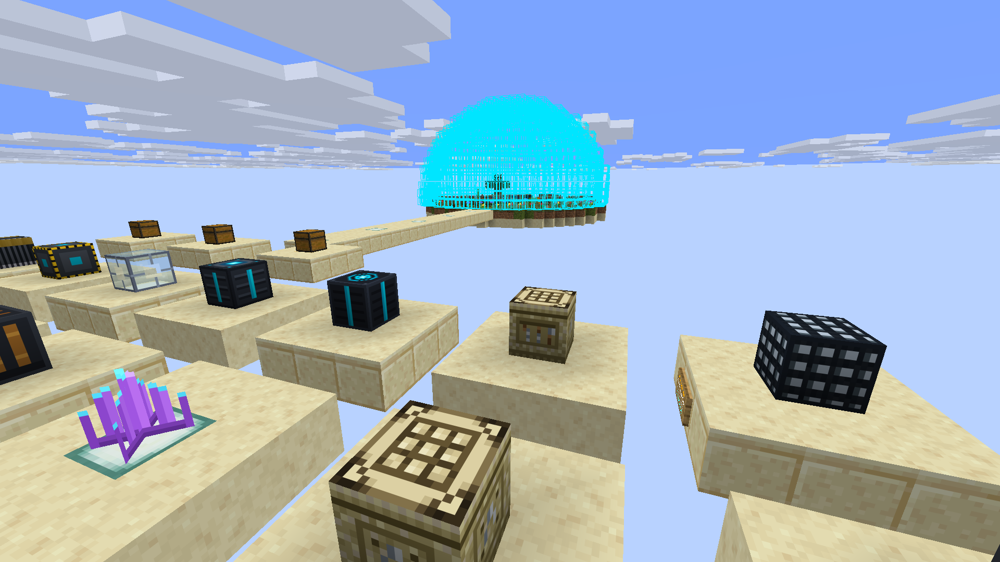

**SandStorm** é um mod de sobrevivência planetária, automação industrial e terraformação para Minecraft 26.3 (Fabric). 

Você é um astronauta perdido em um planeta infestado por **Vermes de Areia**. Sobreviva ao calor inclemente, construa fábricas e transforme o deserto estéril em um oásis.

---

## 📸 Demonstração em Jogo

| Defesa Planetária & Combate | Cúpula de Escudo & Terraformação |
|:---:|:---:|
|  |  |
| *Torretas sônicas repelindo ameaças sem alertar vermes* | *Cúpula de plasma protegendo o oásis verdejante* |

| Automação & Ciborgues | Transporte Ferroviário Maglev |
|:---:|:---:|
| 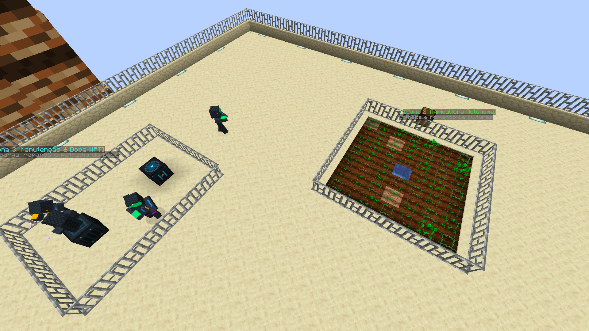 | 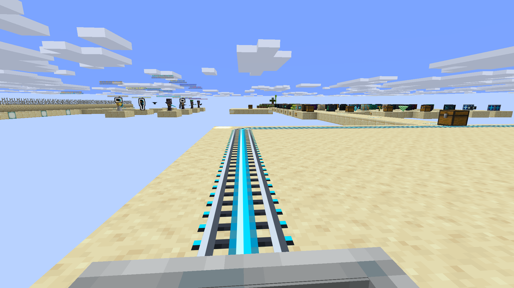 |
| *Ciborgues operando agricultura e estações WPT* | *Linhas de levitação magnética de alta velocidade* |

---

<!-- ENTITY_GALLERY_START -->
## 👾 Entidades & Mobs Cibernéticos

<details>
<summary><b>Clique para expandir a galeria isométrica de entidades (26 modelos)</b></summary>
<br>

<table width="100%">
  <tr>
    <td align="center" width="25%" valign="top">
      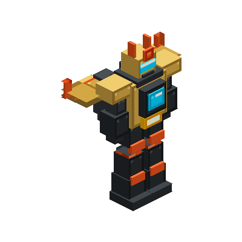<br>
      <b>Titã Megazord</b><br>
      <sub>Veículo Mecatrônico Pesado</sub>
    </td>
    <td align="center" width="25%" valign="top">
      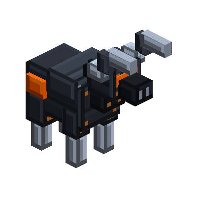<br>
      <b>Presalonga (Fanghorn)</b><br>
      <sub>Escolta Térmica & Combate</sub>
    </td>
    <td align="center" width="25%" valign="top">
      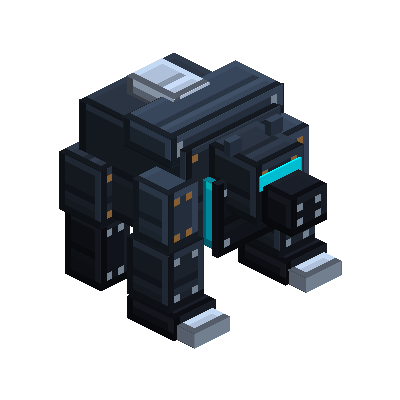<br>
      <b>Garragélida (Frostclaw)</b><br>
      <sub>Predador Criogênico Articular</sub>
    </td>
    <td align="center" width="25%" valign="top">
      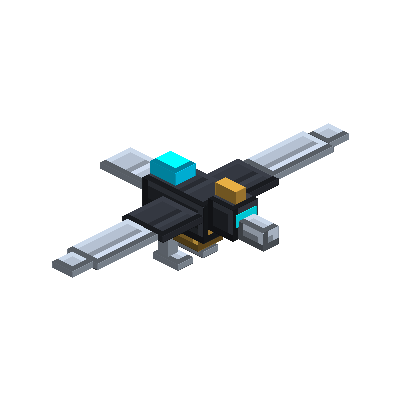<br>
      <b>Falcão Cintilante (Glinthawk)</b><br>
      <sub>Drone Predador Aéreo</sub>
    </td>
  </tr>
  <tr>
    <td align="center" width="25%" valign="top">
      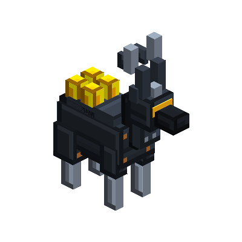<br>
      <b>Pastador (Grazer)</b><br>
      <sub>Coleta Térmica & Terraformação</sub>
    </td>
    <td align="center" width="25%" valign="top">
      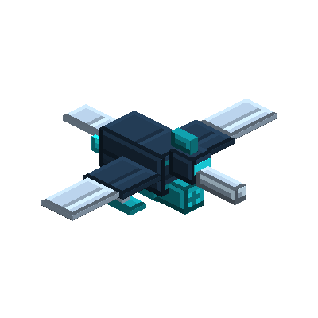<br>
      <b>Asa d'Água (Waterwing)</b><br>
      <sub>Anfíbio Aquático & Aéreo</sub>
    </td>
    <td align="center" width="25%" valign="top">
      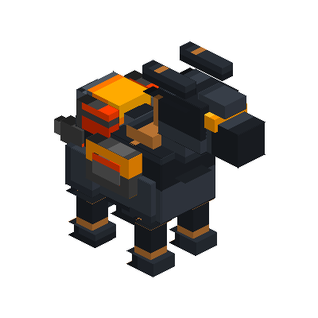<br>
      <b>Corcel Cibernético</b><br>
      <sub>Montaria Rápida & Bateria Móvel</sub>
    </td>
    <td align="center" width="25%" valign="top">
      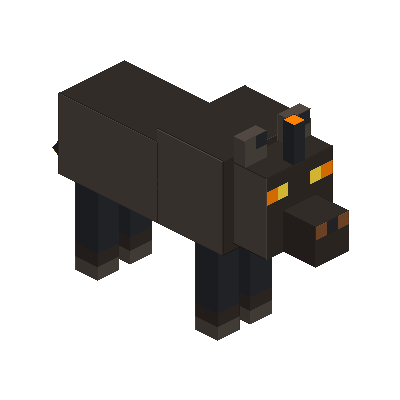<br>
      <b>Cão Cibernético</b><br>
      <sub>Guardião Autônomo & Rastreador</sub>
    </td>
  </tr>
  <tr>
    <td align="center" width="25%" valign="top">
      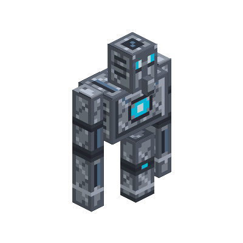<br>
      <b>Golem Cibernético</b><br>
      <sub>Defesa Pesada de Instalações</sub>
    </td>
    <td align="center" width="25%" valign="top">
      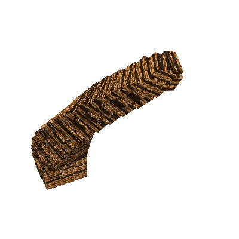<br>
      <b>Verme da Areia (Sandworm)</b><br>
      <sub>Superpredador Sísmico Titânico</sub>
    </td>
    <td align="center" width="25%" valign="top">
      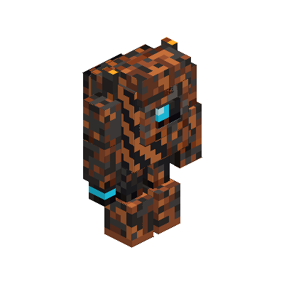<br>
      <b>Sentinela de Sucata</b><br>
      <sub>Patrulheiro Autônomo de Ruínas</sub>
    </td>
    <td align="center" width="25%" valign="top">
      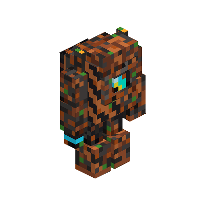<br>
      <b>Sentinela Defeituosa</b><br>
      <sub>Unidade Hostil Corrompida</sub>
    </td>
  </tr>
  <tr>
    <td align="center" width="25%" valign="top">
      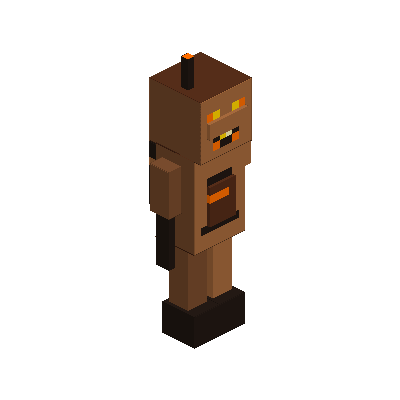<br>
      <b>Autômato Abandonado</b><br>
      <sub>Unidade Decrépita Reciclável</sub>
    </td>
    <td align="center" width="25%" valign="top">
      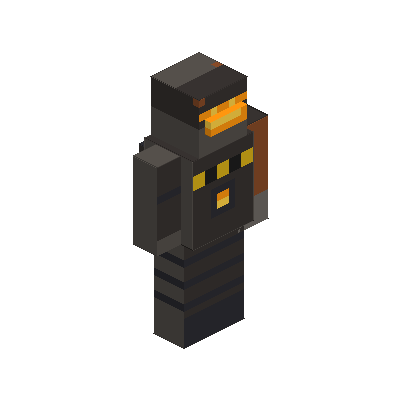<br>
      <b>Unidade Operária</b><br>
      <sub>Androide Auxiliar de Mineração</sub>
    </td>
    <td align="center" width="25%" valign="top">
      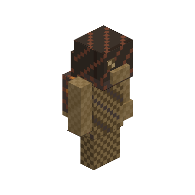<br>
      <b>Sucateiro Nômade</b><br>
      <sub>Comerciante do Deserto Profundo</sub>
    </td>
    <td align="center" width="25%" valign="top">
      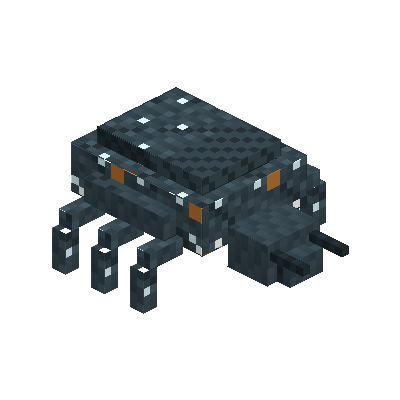<br>
      <b>Besouro Aquífero</b><br>
      <sub>Bio-Reservatório de Água</sub>
    </td>
  </tr>
  <tr>
    <td align="center" width="25%" valign="top">
      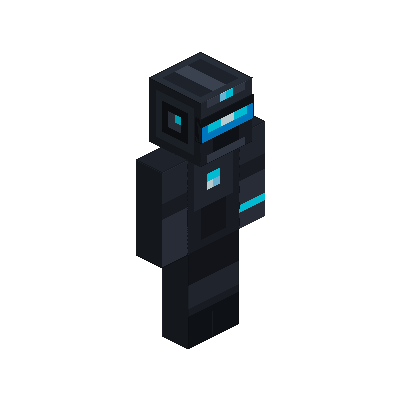<br>
      <b>Ciborgue Escavador</b><br>
      <sub>Especialista em Perfuração</sub>
    </td>
    <td align="center" width="25%" valign="top">
      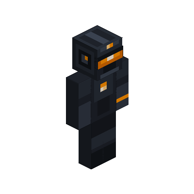<br>
      <b>Ciborgue Construtor</b><br>
      <sub>Especialista em Montagem</sub>
    </td>
    <td align="center" width="25%" valign="top">
      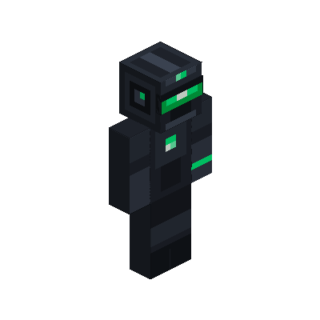<br>
      <b>Ciborgue Colhedor</b><br>
      <sub>Especialista em Agricultura</sub>
    </td>
    <td align="center" width="25%" valign="top">
      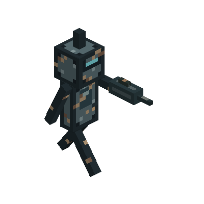<br>
      <b>Drone Explorador</b><br>
      <sub>Reconhecimento & Vigilância Aérea</sub>
    </td>
  </tr>
  <tr>
    <td align="center" width="25%" valign="top">
      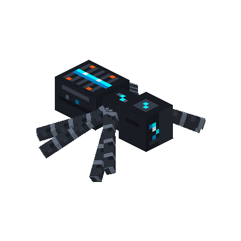<br>
      <b>Drone Rastejador</b><br>
      <sub>Inspeção & Manutenção Interna</sub>
    </td>
    <td align="center" width="25%" valign="top">
      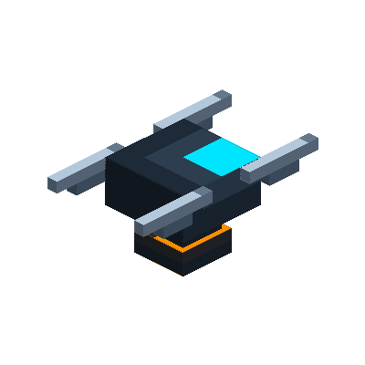<br>
      <b>Drone de Carga</b><br>
      <sub>Logística Autônoma de Itens</sub>
    </td>
    <td align="center" width="25%" valign="top">
      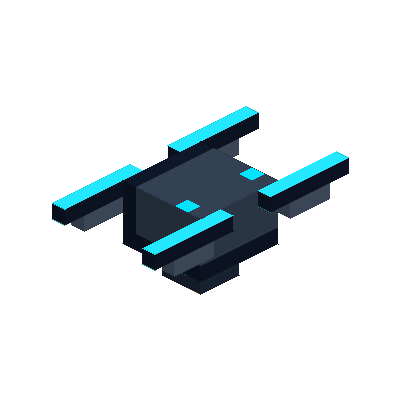<br>
      <b>Drone Construtor</b><br>
      <sub>Fabricação Remota de Estruturas</sub>
    </td>
    <td align="center" width="25%" valign="top">
      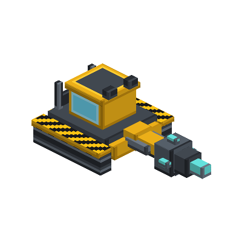<br>
      <b>Veículo Escavador</b><br>
      <sub>Maquinário Pesado Tripulado</sub>
    </td>
  </tr>
  <tr>
    <td align="center" width="25%" valign="top">
      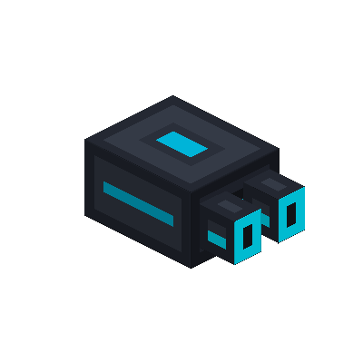<br>
      <b>Torreta Sônica Autônoma</b><br>
      <sub>Defesa Perimetral Anti-Verme</sub>
    </td>
    <td align="center" width="25%" valign="top">
      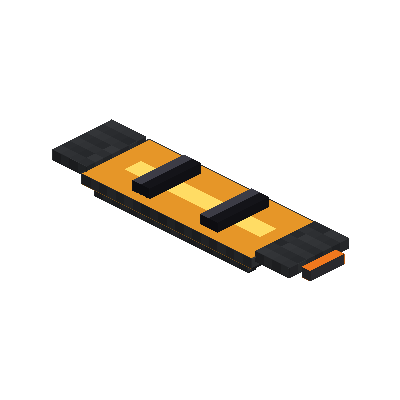<br>
      <b>Prancha de Areia (Sandboard)</b><br>
      <sub>Locomoção Veloz nas Dunas</sub>
    </td>
    <td width="25%"></td>
    <td width="25%"></td>
  </tr>
</table>

</details>
<!-- ENTITY_GALLERY_END -->

---

<!-- BLOCK_GALLERY_START -->
## 🧱 Novos Blocos, Maquinários & Automação

<details>
<summary><b>Clique para expandir o catálogo de maquinários e blocos (24 modelos)</b></summary>
<br>

<table width="100%">
  <tr>
    <td align="center" width="25%" valign="top">
      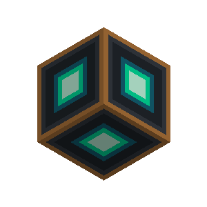<br>
      <b>Terraformador Atmosférico</b><br>
      <sub>Estabilização Climática Global</sub>
    </td>
    <td align="center" width="25%" valign="top">
      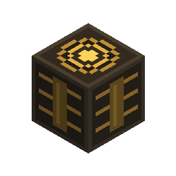<br>
      <b>Pilone de Defesa Acústica</b><br>
      <sub>Repulsor Sísmico Anti-Verme</sub>
    </td>
    <td align="center" width="25%" valign="top">
      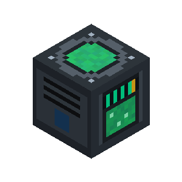<br>
      <b>Vat Biorreator</b><br>
      <sub>Cultura de Biomassa & Enzimas</sub>
    </td>
    <td align="center" width="25%" valign="top">
      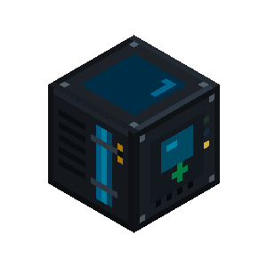<br>
      <b>Cápsula de Biorregeneração</b><br>
      <sub>Cura Celular Rápida de Operadores</sub>
    </td>
  </tr>
  <tr>
    <td align="center" width="25%" valign="top">
      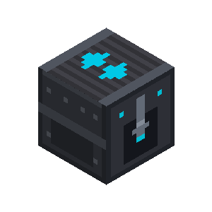<br>
      <b>Linha de Montagem Robótica</b><br>
      <sub>Automação de Chassis & Circuitos</sub>
    </td>
    <td align="center" width="25%" valign="top">
      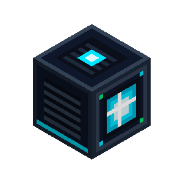<br>
      <b>Controlador Quântico ME</b><br>
      <sub>Núcleo de Rede & Barramento de Dados</sub>
    </td>
    <td align="center" width="25%" valign="top">
      <br>
      <b>Unidade de Discos Quânticos</b><br>
      <sub>Armazenamento Holográfico Massivo</sub>
    </td>
    <td align="center" width="25%" valign="top">
      <br>
      <b>Terminal de Acesso Quântico</b><br>
      <sub>Interface Gráfica de Logística ME</sub>
    </td>
  </tr>
  <tr>
    <td align="center" width="25%" valign="top">
      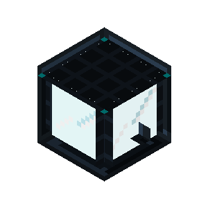<br>
      <b>Filtro Dessalinizador</b><br>
      <sub>Purificação de Água Salobra</sub>
    </td>
    <td align="center" width="25%" valign="top">
      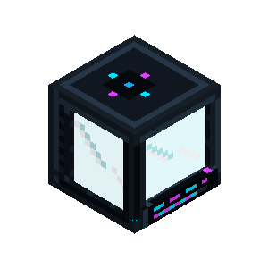<br>
      <b>Fabricador de Nanitas</b><br>
      <sub>Síntese Molecular de Componentes</sub>
    </td>
    <td align="center" width="25%" valign="top">
      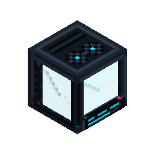<br>
      <b>Impressora 3D de Precisão</b><br>
      <sub>Prototipagem Rápida de Peças</sub>
    </td>
    <td align="center" width="25%" valign="top">
      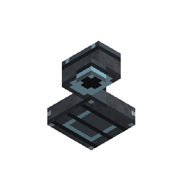<br>
      <b>Turbina Eólica de Tempestade</b><br>
      <sub>Geração Elétrica Cinética Eólica</sub>
    </td>
  </tr>
  <tr>
    <td align="center" width="25%" valign="top">
      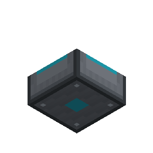<br>
      <b>Pistão Compacto de Lajes</b><br>
      <sub>Automação Redstone de 0.5 Bloco</sub>
    </td>
    <td align="center" width="25%" valign="top">
      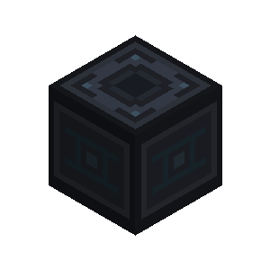<br>
      <b>Portal Subespacial</b><br>
      <sub>Trânsito Quântico Dimensional</sub>
    </td>
    <td align="center" width="25%" valign="top">
      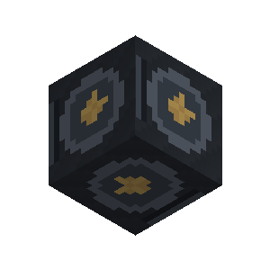<br>
      <b>Controlador de Porta de Cofre</b><br>
      <sub>Acesso Hermético de Alta Segurança</sub>
    </td>
    <td align="center" width="25%" valign="top">
      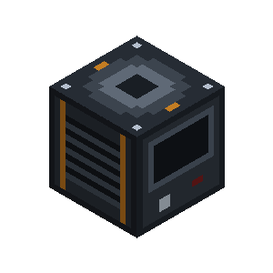<br>
      <b>Perfuratriz de Núcleo Profundo</b><br>
      <sub>Mineração Subterrânea Automatizada</sub>
    </td>
  </tr>
  <tr>
    <td align="center" width="25%" valign="top">
      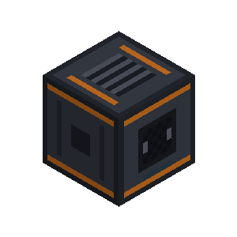<br>
      <b>Fornalha de Arco Elétrico</b><br>
      <sub>Metalurgia Avançada de Superligas</sub>
    </td>
    <td align="center" width="25%" valign="top">
      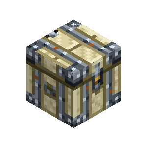<br>
      <b>Caixote de Arenito Selado</b><br>
      <sub>Armazenamento Resistente a Tempestades</sub>
    </td>
    <td align="center" width="25%" valign="top">
      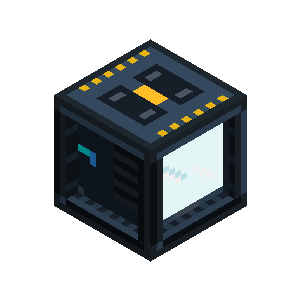<br>
      <b>Refinaria Química</b><br>
      <sub>Fracionamento de Fluidos Fósseis</sub>
    </td>
    <td align="center" width="25%" valign="top">
      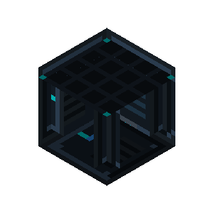<br>
      <b>Condensador de Orvalho</b><br>
      <sub>Captação Passiva de Umidade do Ar</sub>
    </td>
  </tr>
  <tr>
    <td align="center" width="25%" valign="top">
      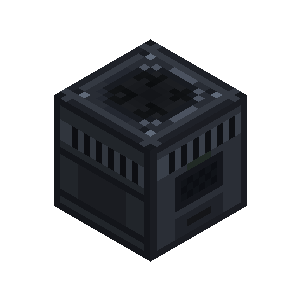<br>
      <b>Extrator de Carbono</b><br>
      <sub>Captura Atmosférica de Polímeros</sub>
    </td>
    <td align="center" width="25%" valign="top">
      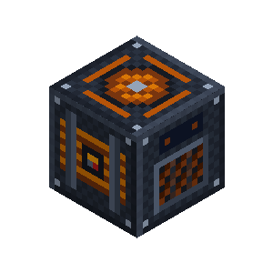<br>
      <b>Gerador Geotérmico</b><br>
      <sub>Conversão Térmica de Lava & Manto</sub>
    </td>
    <td align="center" width="25%" valign="top">
      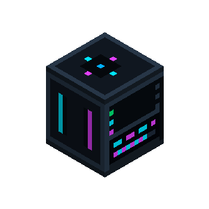<br>
      <b>Acumulador de Estado Sólido</b><br>
      <sub>Armazenamento de Alta Tensão</sub>
    </td>
    <td align="center" width="25%" valign="top">
      <br>
      <b>Câmara Hidropônica</b><br>
      <sub>Cultivo Subterrâneo Otimizado</sub>
    </td>
  </tr>
</table>

</details>
<!-- BLOCK_GALLERY_END -->

---

<!-- WEAPON_GALLERY_START -->
## ⚔️ Arsenal Tático, Armas & Equipamentos

<details>
<summary><b>Clique para expandir o arsenal de armas e equipamentos (16 modelos)</b></summary>
<br>

<table width="100%">
  <tr>
    <td align="center" width="25%" valign="top">
      <br>
      <b>Canhão Sônico</b><br>
      <sub>Arma Acústica Pesada Anti-Verme</sub>
    </td>
    <td align="center" width="25%" valign="top">
      <br>
      <b>Rifle de Plasma</b><br>
      <sub>Fuzil de Precisão Térmico</sub>
    </td>
    <td align="center" width="25%" valign="top">
      <br>
      <b>Faca Vibro-Crys</b><br>
      <sub>Lâmina Crio-Sônica de Dente de Verme</sub>
    </td>
    <td align="center" width="25%" valign="top">
      <br>
      <b>Disruptor EMP</b><br>
      <sub>Desativação de Circuitos Hostis</sub>
    </td>
  </tr>
  <tr>
    <td align="center" width="25%" valign="top">
      <br>
      <b>Canhão Pesado de Plasma</b><br>
      <sub>Artilharia Térmica de Demolição</sub>
    </td>
    <td align="center" width="25%" valign="top">
      <br>
      <b>Projétil Cinético Pesado</b><br>
      <sub>Munição Perfurante de Alta Densidade</sub>
    </td>
    <td align="center" width="25%" valign="top">
      <br>
      <b>Granada de Choque</b><br>
      <sub>Sobrecarga Bioelétrica em Área</sub>
    </td>
    <td align="center" width="25%" valign="top">
      <br>
      <b>Granada de Fumaça</b><br>
      <sub>Ocultamento Térmico e Visual</sub>
    </td>
  </tr>
  <tr>
    <td align="center" width="25%" valign="top">
      <br>
      <b>Bomba de Nutrientes</b><br>
      <sub>Terraformação & Impulso Biológico</sub>
    </td>
    <td align="center" width="25%" valign="top">
      <br>
      <b>Detonador Tático</b><br>
      <sub>Controle Remoto de Detonação</sub>
    </td>
    <td align="center" width="25%" valign="top">
      <br>
      <b>Capacete Espacial</b><br>
      <sub>Suporte Vital & HUD de Varredura</sub>
    </td>
    <td align="center" width="25%" valign="top">
      <br>
      <b>Traje Espacial (Torso)</b><br>
      <sub>Blindagem de Vácuo & Propulsão</sub>
    </td>
  </tr>
  <tr>
    <td align="center" width="25%" valign="top">
      <br>
      <b>Radar de Anomalias</b><br>
      <sub>Detecção de Radiação & Falhas</sub>
    </td>
    <td align="center" width="25%" valign="top">
      <br>
      <b>Ferramenta Reprogramadora</b><br>
      <sub>Recodificação e Hack de Robôs</sub>
    </td>
    <td align="center" width="25%" valign="top">
      <br>
      <b>Uplink Cibernético</b><br>
      <sub>Comando Remoto de Drones & Ciborgues</sub>
    </td>
    <td align="center" width="25%" valign="top">
      <br>
      <b>Prancha de Areia (Sandboard)</b><br>
      <sub>Locomoção Tática de Alta Velocidade</sub>
    </td>
  </tr>
</table>

</details>
<!-- WEAPON_GALLERY_END -->

---

## 📖 Como Jogar (Wiki)

Acesse a **[Wiki do SandStorm](https://github.com/fhfelipefh/SandStorm/wiki)** para documentação técnica completa:
* **[Mecânicas & Lore](docs/wiki/Mecanicas.md):** Suporte à vida do traje, ciclo circadiano, perigo sísmico e terraformação setorial.
* **[Máquinas & Construções](docs/wiki/Maquinas.md):** Catálogo de maquinários, impressoras 3D, nanites, canhões cinéticos e comandos de debug.
* **[Engenharia & Fluxogramas](docs/wiki/Engenharia.md):** Diagramas WPT, dessalinização osmótica e bio-farmacologia.
* **[Lista de Itens & Blocos](docs/wiki/Itens.md):** IDs técnicos e receitas de fabricação.

---

## 🛠️ Onde Baixar & Instalação

O **SandStorm** está disponível oficialmente em duas plataformas:

* **[CurseForge](https://www.curseforge.com/minecraft/mc-mods/sandstorm)**: Instale pelo app do CurseForge ou baixe os arquivos diretamente na página.
* **[Modrinth](https://modrinth.com/mod/sandstorm-felipehonorio55)**: Baixe pelo Modrinth App ou pela página oficial do projeto.

### Instalação Manual:
1. Instale o **Fabric Loader 0.19.5+** para Minecraft 26.3 / 1.21.4.
2. Baixe a versão correspondente da **Fabric API** e o arquivo `.jar` do **SandStorm**.
3. Coloque ambos os arquivos na sua pasta `.minecraft/mods`.

---

## 💻 Desenvolvimento

O projeto requer **Java 25** e usa Gradle.

```bash
git clone https://github.com/fhfelipefh/SandStorm.git
cd SandStorm

# Testar o jogo localmente
.\gradlew runClient

# Compilar o mod (.jar)
.\gradlew build
```
