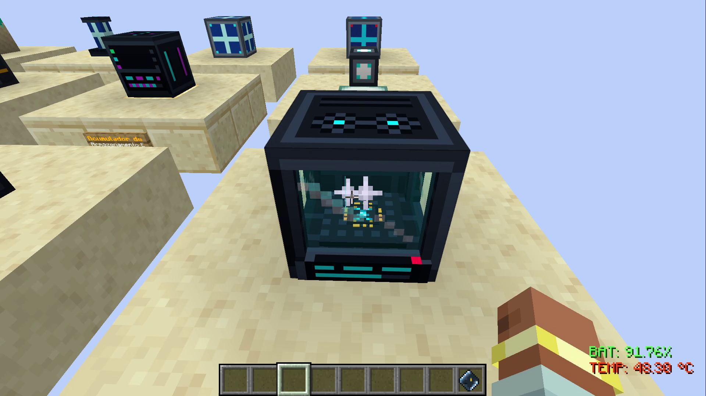
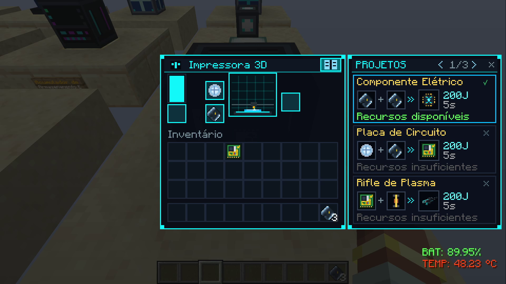
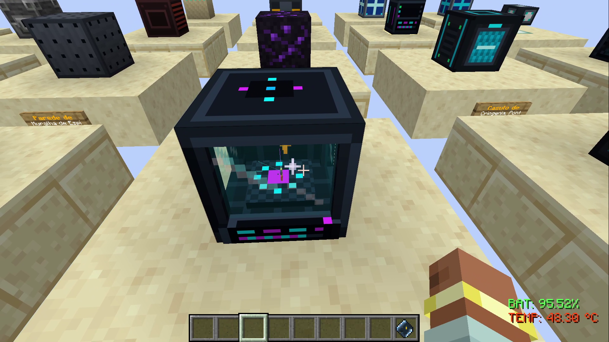
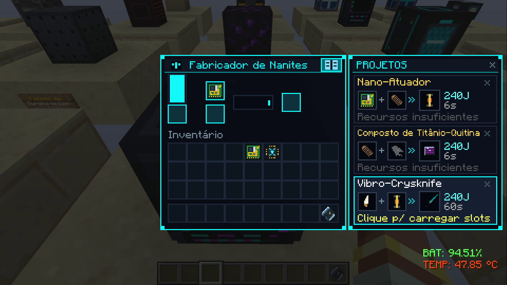
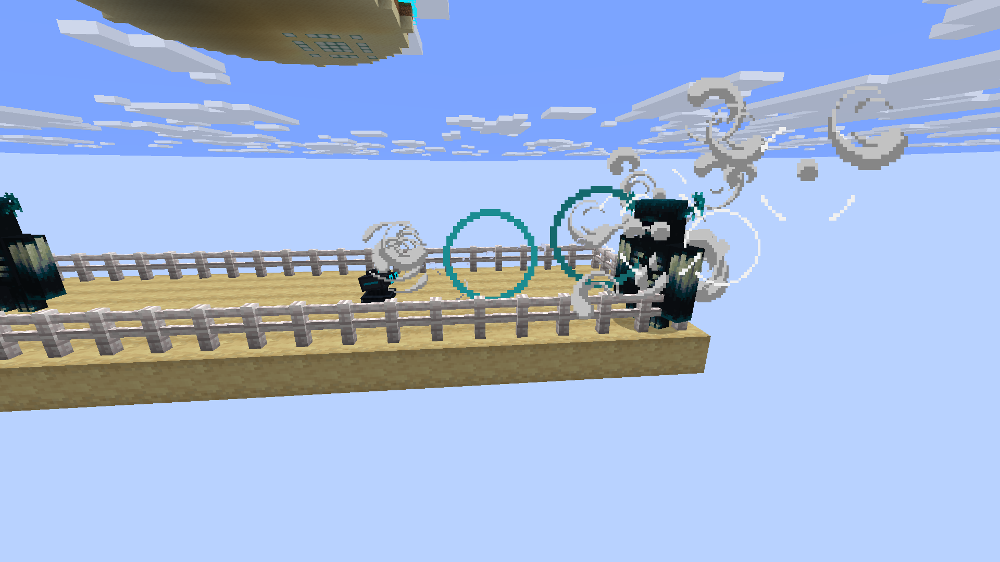
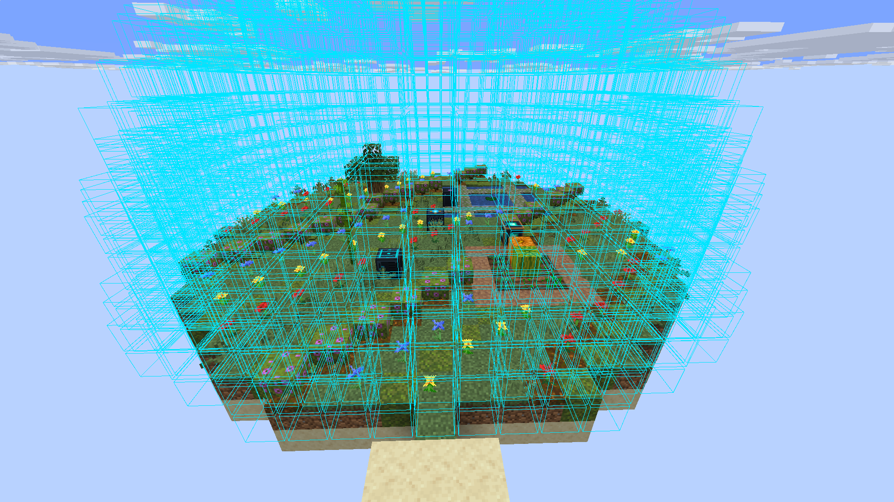

# Demonstração Visual das Máquinas & Construções

> [!NOTE]
> Todos os recursos visuais do SandStorm são capturados **100% diretamente da engine do jogo** (Minecraft 1.21.4 / Fabric). Para visualizar qualquer uma das construções e máquinas completas no seu próprio mundo, utilize os comandos in-game `/sandstorm debug setup <instalação>`.

---

## 📸 Galeria Fotográfica de Maquinários em Operação

### 🖨️ Manufatura Aditiva: Impressora 3D Industrial
A Impressora 3D realiza a micro-fabricação de wafers de silício, chips de telemetria e ferramentas espaciais de precisão.

| Instalação em Funcionamento | Interface de Controle e Blueprint |
|:---:|:---:|
|  |  |
| *Bloco da Impressora 3D conectado à malha energética WPT* | *Painel de seleção de projetos, progresso e buffer térmico* |

---

### 🔬 Síntese de Precisão: Fabricador de Nanorobôs
Capaz de sintetizar ligas moleculares e nanites para montagem de peças robóticas de mechas e ciborgues.

| Instalação do Fabricador | Painel de Montagem de Nanites |
|:---:|:---:|
|  |  |
| *Montagem de ligas de titânio sob atmosfera inerte* | *Slots de insumos químicos, matriz de montagem e energia* |

---

### 🛡️ Defesa Tática & Repulsão Sônica
A Torreta Sônica Autônoma rastreia inimigos em 360° e emite pulsos concussivos que paralisam e repelem invasores sem alertar os predadores subterrâneos.

*Torreta Sônica Autônoma operando em modo de defesa perimétrica contra ameaças.*

---

### 🌐 Cúpula Planetária de Escudo de Plasma
O Gerador de Escudo de Plasma projeta uma rede de linhas de força eletromagnéticas em raio expansível, criando zonas seguras contra bombardeios e ataques biológicos.

*Escudo de Plasma sustentando e protegendo a biosfera e a flora do oásis terraformado.*

---

## 🔬 Catálogo de Maquinários Tecnológicos Nativos

| Máquina / Instalação | Textura Nativa do Jogo | Função e Arquitetura no Jogo | Comando de Spawn In-Game |
|:---:|:---:|---|---|
| **Gerador de Escudo de Plasma** *(Plasma Shield Generator)* |  | Gerador planetário de 1.000.000 J conectado à malha WPT. Projeta domo de contenção com repulsão dinâmica de vermes de areia colossais, desintegração de projéteis e choque cinético em ameaças. | `/sandstorm debug setup plasma_defense_complex` |
| **Canhão Cinético Anti-Titã** *(Kinetic Railgun)* |   | Artilharia pesada ferroviária de 250.000 J. Varredura automática em 64m priorizando Sandworms, disparando projéteis hipercinéticos com 50.0 de dano e repulsão vetorial. | `/sandstorm debug setup plasma_defense_complex` |
| **Pilão de Defesa Acústica** *(Acoustic Defense Pylon)* |  | Torre perimétrica de cancelamento de ressonância sísmica em 32m de raio, suprimindo o acúmulo de passos e mineração que atrai predadores do subsolo. | `/sandstorm debug setup plasma_defense_complex` |
| **Cápsula de Estase Quântica** *(Quantum Sleeper Pod)* |   | Câmara criogênica de 100.000 J conectada à malha WPT sem fio. Realiza a bio-síntese do corpo do clone consumindo nutrientes e biocompostos (quitosana, trealose, glicerol) e permite o **Ego-Casting**. | `/sandstorm debug setup clone_facility` |
| **Torre Holo-Tática & Radar 3D** *(Holo-Tactical Spire)* |   | Pilar de comando militar com cúpula holográfica. Conecta-se à mente de ciborgues autônomos via `neural_synapse_link`, transmitindo ordens macro-estratégicas. | `/sandstorm debug setup cyborg_outpost` |
| **Incubadora Criogênica de Ciborgues** *(Cyborg Incubator Vat)* |  | Tanque biônico com fluido eletrolítico de titânio para montagem e impressão celular de ciborgues especialistas. | `/sandstorm debug setup cyborg_outpost` |
| **Doca de Recarga Rápida** *(Cyborg Docking Station)* |  | Plataforma de indução eletromagnética para carregamento rápido e sincronização de telemetria dos robôs em operação autônoma contínua. | `/sandstorm debug setup cyborg_outpost` |
| **Pod de Bio-Regeneração** *(Bio-Regeneration Pod)* |  | Câmara estéril médica para purificação celular e regeneração rápida de tecidos biológicos do explorador espacial. | `/sandstorm debug setup medbay_clinic` |
| **Biorreator de Batelada Quimiostato** *(Bioreactor Vat)* |  | Quimiostato industrial de fermentação celular contínua para cultivo de extremófilos botânicos (quitosana, trehalose, glicerol e neuro-alcaloides). | `/sandstorm debug setup bioreactor_lab` |
| **Processador Atmosférico** *(Atmospheric Terraformer)* |  | Usina planetária de terraformação setorial. Projeta uma cúpula de microclima dinâmico que transforma areia em solo fértil e lagos de água doce. | `/sandstorm debug setup terraformer_dome` |
| **Filtro de Dessalinização** *(Desalination Filter)* |  | Unidade de filtração osmótica que purifica aquíferos salobres subterrâneos em água potável estéril e subprodutos de sal mineral. | `/sandstorm debug setup starter_base` |
| **Impressora 3D Industrial** *(Printer 3D)* |  | Manufatura aditiva de precisão para wafers de silício, placas de circuito integrado e ferramentas científicas. | `/sandstorm debug setup starter_base` |
| **Fabricador de Nanorobôs** *(Nanite Fabricator)* |  | Síntese de nano-atuadores e circuitos avançados para maquinário pesado e montagem de mechas. | `/sandstorm debug setup starter_base` |

---

## 🏗️ Catálogo de Instalações & Comandos de Demonstração Rápida (Debug)

Para criadores de conteúdo, desenvolvedores e administradores, o mod inclui comandos para geração instantânea de instalações tecnológicas completas e kits de desenvolvimento:

| Instalação / Complexo | Comando In-Game | Estrutura Gerada |
|---|---|---|
| **Complexo Geotérmico e Lito-Plasma** | `/sandstorm debug setup geothermal_well` | Perfuratriz de poço do manto, extrator de lito-plasma, trocador térmico supercrítico e circuito de fluidos |
| **Complexo de Defesa de Plasma** | `/sandstorm debug setup plasma_defense_complex` | Cúpula de escudo de plasma, canhão cinético municiado com slugs e pilões acústicos anti-verme |
| **Complexo de Clonagem Quântica** | `/sandstorm debug setup clone_facility` | Duas Cápsulas de Estase (`quantum_sleeper_pod`) conectadas, telemetria e insumos para teste imediato de Ego-Casting |
| **Canteiro de Megaestrutura** | `/sandstorm debug setup megastructure_site` | Construtor de Megaestruturas ancorado com blueprints e baús de insumos |
| **Posto Avançado de Ciborgues** | `/sandstorm debug setup cyborg_outpost` | Docas de ancoragem, incubadora criogênica, telemetria e ciborgues operantes |
| **Clínica Médica e MedBay** | `/sandstorm debug setup medbay_clinic` | Câmara de bio-regeneração estéril e ampolas farmacológicas avançadas |
| **Laboratório de Biorreatores** | `/sandstorm debug setup bioreactor_lab` | Quimiostato industrial, cepas extremófilas e insumos de fermentação |
| **Oficina Molecular** | `/sandstorm debug setup molecular_workshop` | Modificador molecular com catalisadores de fissão e transmutação |
| **Usina de Energia Planetária** | `/sandstorm debug setup power_station` | Matriz solar de alta eficiência e acumuladores de estado sólido |
| **Complexo de Refinaria** | `/sandstorm debug setup refinery_complex` | Torres de craqueamento térmico e tanques de hidrocarbonetos pesados |
| **Domo de Oásis Terraformado** | `/sandstorm debug setup terraformer_dome` | Processador Atmosférico com cúpula de microclima e oásis verdejante |
| **Fortaleza de Espinhos** | `/sandstorm debug setup spike_fortress` | Perímetro com paredes de titânio, espinhos eletrizados e portões motorizados |
| **Base Inicial de Sobrevivência** | `/sandstorm debug setup starter_base` | Posto balanceado com filtro de dessalinização, água e energia solar |

> **Kits de Demonstração e Equipamentos:** Obtenha conjuntos completos de equipamentos de desenvolvimento com o comando `/sandstorm debug phase all` ou gere instalações prontas para testes com `/sandstorm debug setup <instalação>`.

---

## 🏛️ Matrizes e Estruturas Multibloco de Alta Engenharia

O SandStorm introduz instalações de grande porte que exigem arranjos tridimensionais exatos de múltiplos blocos tecnológicos. Todas as estruturas suportam **projeção holográfica no mundo** através do **Survival Datapad**.

| Estrutura Multibloco | Dimensões & Orientação | Componentes Exigidos | Aplicação & Benefícios |
|---|:---:|---|---|
| **Torre Solar & Relé WPT** *(WPT Relay Tower)* | 3x4x3 Vertical | Base de Concreto Reforçado, 4 Relés WPT perimétricos, Eixo de Bobinas Piezoelétricas e Painel Solar no topo | Transmissão de energia sem fio de altíssima fidelidade e alcance ampliado para bases remotas |
| **Câmara de Cofre Blindada** *(Vault Door Chamber)* | 3x3x3 Cúbica | Paredes de Chapa de Aço Escovado, Blocos de Junção Blindados e Porta de Cofre Automatizada de 3x3 | Armazenamento de altíssima segurança resistente a tempestades de areia e impactos sísmicos |
| **Portal Subespacial** *(Subspace Gateway)* | 5x4x3 Pórtico | Almofadas de Teletransporte Quântico, Bobinas Piezoelétricas de Condensação e Lentes de Foco Gravitacional | Enlace quântico para teletransporte instantâneo de exploradores e frotas de veículos |
| **Cluster de Computação Quântica** *(Quantum Computer Cluster)* | 3x3x3 Gabinete | Processadores Quânticos Centrais, Gabinetes de Discos Ópticos, Painéis de Servidor e Terminal Holográfico | Descriptografia acelerada de núcleos de dados ancestrais e cálculo de rotas orbitais |
| **Complexo de Lançamento Orbital** *(Orbital Launch Complex)* | 5x5x5 Plataforma | Estação Terrestre de Controle, Antena Parabólica de Satélite, Acumuladores de Carga e Canhão de Massa | Injeção de sondas meteorológicas, satélites de GPS e reabastecimento de estações espaciais |
| **Matriz de Super Pistões** *(Super Piston Array)* | 3x2x3 Horizontal | 3 Super Pistões Cinéticos, Pistão Tectônico de Britagem e Meia-Lajes Reforçadas | Movimentação massiva de até 64 blocos em linha e trituração contínua de minérios brutos |

---

## 🦾 Androides de Automação & Fauna Mecânica

| Máquina / Entidade | Função Primária | Armamento / Habilidade | Recursos Obtidos |
|---|---|---|---|
| **Grazer** | Coleta autônoma de gramíneas e biomassa | Fuga em alta velocidade, detecção de ameaças | Fibras de carbono, bio-óleo, sucata metálica |
| **Fanghorn** | Escavação e aeração de solos desérticos | Investida de chifres ramificados (dano concussivo) | Ligas de titânio, chifres condutivos, circuitos |
| **Frostclaw** | Regulação térmica e refrigeração de zonas de calor | Golpes criogênicos, tempestade de gelo localizada | Cápsulas de líquido criogênico, liga de blindagem |
| **Glinthawk** | Patrulha aérea e reciclagem de detritos | Rasantes de alta precisão, bicadas penetrantes | Lentes ópticas, sensores de voo, pastilhas de silício |
| **Waterwing** | Exploração de aquíferos e navegação submersa | Nado de alta propulsão e voo anfíbio | Filtros de membrana osmótica, reservas de água potável |
